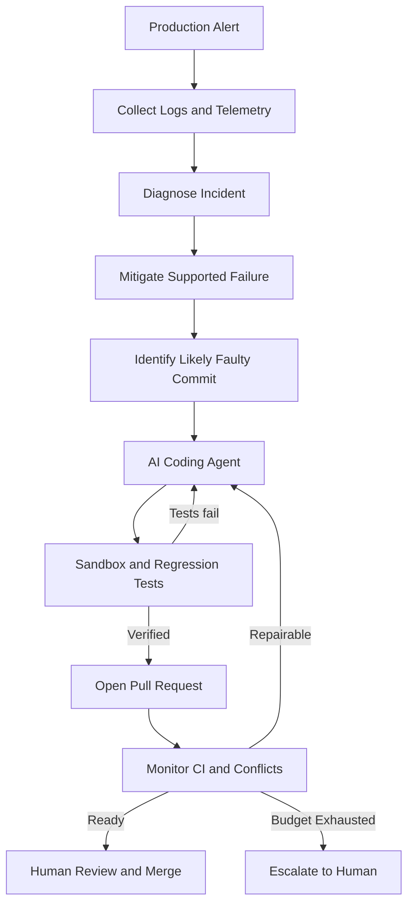

# AutoSRE — Team Zero-Ops

### From production incident to verified fix.

AutoSRE is an AI-powered Site Reliability Engineering agent that investigates production incidents, mitigates supported database failures, identifies likely root causes, and uses a coding agent to generate and verify fixes in a sandbox.

It then opens a pull request, handles bounded repair attempts for failing CI or merge conflicts, and stops when the fix is ready for human review.

**Our principle: automate the investigation and repair loop. Keep the final merge under human control.**

---

## The problem

When production breaks, engineers must correlate alerts, logs, database telemetry, Git history, code changes, tests, and pull requests—often under pressure.

AutoSRE connects these steps into one bounded workflow.

## How it works



### Two closed feedback loops

- **Fix loop:** investigate, edit, test, learn from failures, and retry within a bounded budget.
- **PR repair loop:** monitor CI and merge conflicts, attempt repairs, and escalate unresolved failures.

## Key features

- **Incident diagnosis:** use database telemetry, logs, and diagnostic evidence.
- **Root-cause correlation:** rank likely faulty commits using Git history and blame.
- **AI-powered remediation:** investigate code, propose patches, and run tests through guarded tools.
- **Sandbox verification:** require the regression test to fail against the original code and the project test suite to pass against the patch.
- **PR automation:** create a reviewable fix and post-mortem, then attempt bounded repair rounds.
- **Live incident dashboard:** inspect timelines, execution steps, diffs, sandbox runs, and audit records.
- **Human-controlled delivery:** the agent does not perform the final merge.
- **Honest execution modes:** distinguish live LLM runs from cached, replay, and fallback behavior.

## Technology stack

| Layer | Technologies |
|---|---|
| Backend | Python, Django 5, Django REST Framework |
| Agent orchestration | LangGraph |
| LLM providers | Groq, NVIDIA Nemotron |
| Frontend | React, TypeScript, Vite |
| Database | PostgreSQL 16 |
| Sandbox | Docker |
| Integrations | GitHub, local delivery provider |
| Live updates | Server-Sent Events (SSE) |

Projects can specify build and test commands through `.autosre.yml`, with auto-detection for Python, Node.js, Go, and Java. PostgreSQL is the initial database integration.

## Safety by design

| Protection | Purpose |
|---|---|
| Restricted file changes | Limit edits to permitted files and new tests |
| Patch-size limit | Enforce the configured 50-line source-change limit |
| Secret handling | Scrub sensitive values and reject detected secrets in patches |
| Risky-code checks | Detect configured dangerous patterns |
| Regression verification | Validate the original failure and the proposed fix |
| Bounded autonomy | Maximum 3 fix attempts and 5 PR repair rounds |
| Isolated test execution | Docker restrictions, resource limits, and timeouts |
| Human approval | Keep final merging under human control |
| Escalation | Stop when safety checks or retry budgets are exhausted |

**Security note:** Pattern-based guardrails are not a complete security boundary. The Docker runner provides the configured isolation controls; the subprocess fallback is not isolated and must not be used for untrusted code. Build and installation commands also require appropriate isolation.

## Quick start

### Requirements

- Python 3.11+
- Git 2.38+
- Node.js 18+
- Docker Desktop running

### 1. Clone the repository

```bash
git clone https://github.com/shv-codes/zero-ops-autosre.git
cd zero-ops-autosre
```

### 2. Set up the environment

```bash
python scripts/setup.py
```

### 3. Start AutoSRE

```bash
python scripts/dev.py
```

Open **http://127.0.0.1:5173**, then navigate to **Controls → Start incident**.

### 4. Run the demo

```bash
python scripts/demo.py --conflict --merge
```

This exercises the demo incident workflow, including a simulated teammate conflict and PR repair.

**Important:** Without Docker, sandbox execution falls back to a non-isolated subprocess. Do not use that fallback to execute untrusted code.

## Live LLM and GitHub integration

Configure `.env` for live model execution:

```dotenv
AUTOSRE_MODE=live
LLM_PROVIDER=groq
GROQ_API_KEY=your_groq_api_key
```

For GitHub delivery, configure the appropriate GitHub App credentials:

```dotenv
DELIVERY_PROVIDER=github
GITHUB_REPO=your-user/victim-service
GITHUB_APP_ID=your_github_app_id
GITHUB_APP_PRIVATE_KEY_PATH=secrets/github-app.pem
TARGET_REPO_PATH=var/victim_repo_github
```

Then select **Controls → Connect GitHub**.

See the [GitHub App setup guide](docs/GITHUB_APP_SETUP.md) for detailed instructions.

Keep all credentials out of source control. If the LLM is unavailable and AutoSRE falls back to recorded decisions, report that run as a fallback—not as a successful live-AI run.

## API overview

The REST API is exposed under `/api/v1`.

| Endpoint | Purpose |
|---|---|
| `GET /health` | Health check |
| `GET /system` | System and dependency status |
| `POST /alerts` | Receive incident alerts |
| `GET /incidents` | List incidents |
| `GET /incidents/{id}` | Incident details and timeline |
| `GET /incidents/{id}/stream` | Live updates through SSE |
| `GET /incidents/{id}/diff` | Proposed code changes |
| `GET /incidents/{id}/postmortem` | Incident post-mortem |
| `GET /incidents/{id}/audit` | Audit trail |
| `GET /guardrails` | Guardrail status |
| `GET /telemetry/connections` | Database connection telemetry |
| `GET /github/status` | GitHub integration status |

Additional configuration, sandbox, and GitHub connection endpoints are available in the implementation.

## Testing

Run the backend tests:

```bash
.venv/bin/python -m pytest backend
```

Run the victim-service tests:

```bash
.venv/bin/python -m pytest victim_service
```

On Windows, replace `.venv/bin/python` with `.venv\Scripts\python.exe`.

Docker and PostgreSQL integration tests may be skipped if their required services are unavailable. Inspect the test report and skipped-test count before claiming that the full suite passed.

## Repository structure

```text
zero-ops-autosre/
├── backend/
│   ├── agent/          # Agent pipeline and coding tools
│   ├── correlation/    # Commit scoring and Git blame
│   ├── diagnostics/    # Diagnosis and mitigation
│   ├── delivery/       # Local and GitHub delivery
│   ├── guardrails/     # Safety and patch validation
│   ├── incidents/      # Incident lifecycle and API
│   ├── sandbox/        # Docker runner and fallback
│   ├── telemetry/      # Database adapters
│   └── workspace/      # Repository and branch operations
├── frontend/           # React + TypeScript dashboard
├── victim_service/     # Demo application and tests
├── infra/postgres/     # PostgreSQL configuration
├── docs/               # Architecture and setup guides
├── scripts/            # Setup, development, and demo scripts
├── docker-compose.yml
└── README.md
```

## Documentation

- [Architecture and workflow](docs/HOW_IT_WORKS.md)
- [Implementation plan](docs/IMPLEMENTATION_PLAN.md)
- [GitHub App integration](docs/GITHUB_APP_SETUP.md)

## Limitations

AutoSRE is a hackathon-stage project. Its effectiveness depends on the quality of available telemetry, the supported incident type, project configuration, LLM behavior, permissions, and test coverage.

- Root-cause correlation identifies likely causes; it does not prove causation.
- Passing tests do not guarantee a defect-free patch.
- Pattern-based checks cannot detect every dangerous change.
- Automatic remediation is limited to supported scenarios.
- Live AI, replay, and fallback runs must be evaluated separately.
- Unsafe or unresolved incidents require human investigation.

## Our vision

**Move incident response from alert to verified, reviewable change—with bounded autonomy, auditable evidence, and a human in control.**

Built by **Team Zero-Ops** for the Google Hackathon.

